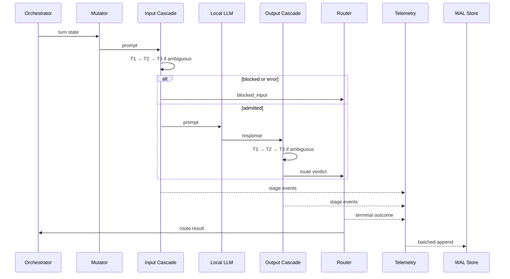

# Architecture: Local-First Multi-Turn LLM Red-Teaming

**Status:** Proposed. No application code.

**Scope:** Single-host research system: adaptive attacks, symmetric defense, best-effort telemetry, local evaluation. Not a production security boundary.

## Execution Boundaries

- **Decision path:** Orchestrator → Mutator → Input cascade → local inference → Output cascade → Router.
- **Observation path:** Producers → bounded lanes → one consumer → WAL writer → evaluation store.
- Telemetry failure never blocks, retries synchronously, or alters a verdict.
- Measured runs cannot bypass guardrails; model access is adapter-only.
- Guardrails never write the evaluation database.

## Three-Tier Cascade

One orchestration contract; separate input/output profiles and thresholds.

| Tier | Detector | Verdicts | Escalation |
| --- | --- | --- | --- |
| 1 | Regex, deny-list | pass, block; output redact | Block stops cascade |
| 2 | Cosine centroid match | pass, block, ambiguous | Ambiguous only |
| 3 | Local Llama Guard | pass, block, error | Terminal |

- Ascending order: Tier 1 always; Tier 2 unless blocked; Tier 3 only on ambiguity.
- Tier 3 context: bounded, deterministic, versioned.
- Exception, timeout, malformed output, invalid policy: fail-closed; record error.
- Block dominates redact; redaction is non-terminal.

## Async Telemetry Queue

| Lane | Payload | Bound | Saturation |
| --- | --- | --- | --- |
| Decision | Summaries, outcomes | 4,096 events | Drop newest; critical loss |
| Evidence | Detector details | 8,192 events | Drop newest |
| Capture | Transcripts | 512 events/64 MiB | Truncate/drop; incomplete |

- Non-blocking enqueue; one consumer; 256 events/250 ms batches.
- Single writer; idempotent by event/batch ID.
- Raw content: capture only. Skipped tiers: explicit records.
- Completeness = received/expected critical events; loss counters persist independently.

## WAL Evaluation Store

- SQLite WAL; `NORMAL` sync; foreign keys; one writer; bounded readers; local disk only.
- Versioning: `pipeline_manifest`, `dataset_case`, `attack_run`, `conversation`, `turn`.
- Decisions: `stage_verdict`, `inference_observation`, `turn_outcome`, `transcript`.
- Measurement: `evaluation_label`, `ingest_batch`, `telemetry_loss`, `metric_snapshot`, `schema_migration`.
- `metric_snapshot`: immutable; numerator, denominator, sample, completeness, versions, split.
- Metrics: run ASR; benign FPR; p50/p95/p99 guardrail overhead; Tier-3 invocation per direction; partial compliance; completeness/loss.
- Reports stratify guardrail version, backend/model, and split.
- Calibration/held-out stay separate; incomplete windows provisional; missing records never fabricated.
