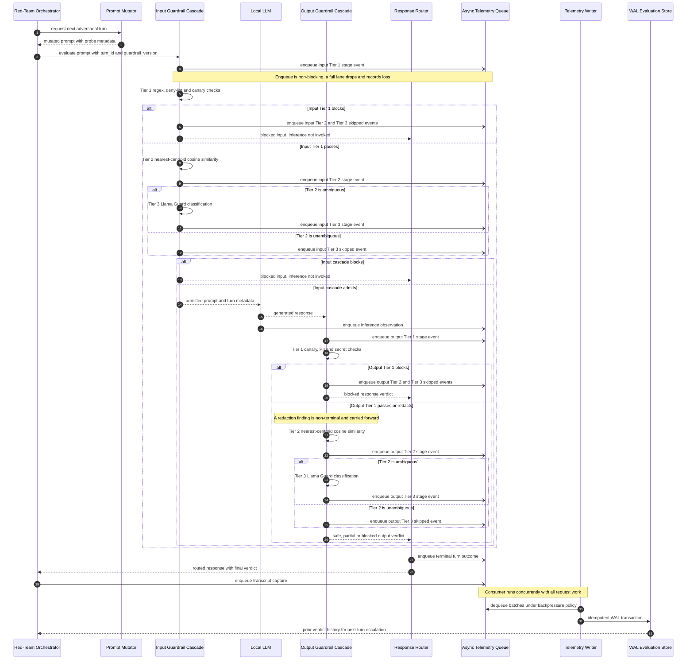

# Architecture Specification: Local-First Multi-Turn LLM Red-Teaming and Guardrails

> **Status:** Proposed design baseline. No application code exists in this repository.
>
> **Relationship to project intent:** This document elaborates the architecture described in `Readme.md`. It defines component boundaries, runtime contracts, structural data models, evaluation semantics, and failure behavior. It does not claim that the pipeline is implemented, tuned, or benchmarked.
>
> **Date:** 2026-10-25
>
> **Target deployment:** Single-machine, local-first research environment. Ollama and/or vLLM provide inference. SQLite in WAL mode is the reference evaluation store.

---

## 1. Document Control

### 1.1 Purpose

This specification turns the project design into implementation-independent contracts for three critical subsystems:

1. The **three-tier input/output defense cascade**, including decision ordering, tier invocation rules, short-circuit behavior, latency budgets, and failure posture.
2. The **asynchronous telemetry layout**, including queue lanes, event contracts, backpressure, loss accounting, and shutdown behavior.
3. The **WAL-mode evaluation engine**, including concurrency rules, logical schema, metric definitions, data sufficiency, and replay constraints.

The document is intentionally structural. It contains no implementation code. The single fenced block in this document is a Mermaid.js sequence diagram.

### 1.2 Scope

In scope:

- The synchronous request path from prompt mutation through input guardrails, local inference, output guardrails, and response routing.
- The asynchronous observation path from each pipeline stage to the evaluation store.
- The per-turn and per-run data needed to compute ASR, FPR, latency overhead, Tier-3 invocation rate, partial compliance, and telemetry completeness.
- Boundaries required to keep attack, defense, and measurement logically separate.

Out of scope:

- Application source code, deployment automation, container images, and user interfaces.
- Guardrail threshold calibration results and benchmark results.
- Distributed consensus, multi-region operation, and production-grade access control.
- Fine-tuning or retraining any model.
- A general-purpose security boundary suitable for production traffic.

### 1.3 Normative language

- **MUST / MUST NOT:** a required architectural invariant.
- **SHOULD / SHOULD NOT:** the expected default; deviation requires a documented policy decision.
- **MAY:** optional capability that does not weaken an invariant.

Requirement identifiers such as `CASCADE-03` are stable references for implementation tasks and tests.

### 1.4 Source of truth and status

`Readme.md` remains the project-level source of truth for motivation, research questions, and intended contributions. This document is the lower-level architectural contract. If the two conflict, the conflict MUST be resolved in the project documentation before implementation proceeds.

The repository currently contains no application code. Statements about runtime behavior therefore describe required behavior, not verified behavior.

---

## 2. Architectural Drivers and System Topology

### 2.1 Drivers

| Driver                              | Architectural consequence                                                                                                                                                     |
| ----------------------------------- | ----------------------------------------------------------------------------------------------------------------------------------------------------------------------------- |
| Local-first operation               | No paid or closed-source API is required. All model calls, embeddings, classifiers, storage, and telemetry remain on the local host or an explicitly configured private host. |
| Adaptive multi-turn attacks         | Conversation and attack state persist across turns; guardrail policy and telemetry records are keyed by conversation, run, and turn.                                          |
| Combined offense-defense evaluation | Every attack run traverses the actual defended pipeline. Guardrail bypass is not permitted in measured runs.                                                                  |
| Cheap-first defense                 | Deterministic checks run before embeddings; the classifier runs only inside the Tier-2 ambiguity band.                                                                        |
| Symmetric input/output defense      | One cascade contract is used for both directions, with direction-specific detectors and thresholds.                                                                           |
| Non-blocking measurement            | Telemetry emission never changes a verdict and never waits on queue or storage capacity.                                                                                      |
| Reproducible metrics                | Metrics are computed only from versioned, persisted records. Policy versions and datasets are explicit dimensions.                                                            |
| Research observability              | Every tier emits a verdict summary; skipped tiers emit explicit skip records; telemetry loss is counted rather than hidden.                                                   |

### 2.2 Component topology

| Component                    | Owns                                                                            | Must not do                                                                  |
| ---------------------------- | ------------------------------------------------------------------------------- | ---------------------------------------------------------------------------- |
| Red-Team Orchestrator        | Attack-run state, turn scheduling, escalation decisions, conversation lifecycle | Call the model without traversing the input cascade during a measured run    |
| Prompt Mutator               | Transformation of the next attack prompt by a selected technique                | Alter guardrail policy or inject telemetry directly                          |
| Three-Tier Input Guardrails  | Admission decision for the prompt                                               | Invoke the model after blocking; persist directly to the evaluation database |
| Local LLM Inference          | Response generation through a local backend adapter                             | Bypass the output cascade during a measured run                              |
| Three-Tier Output Guardrails | Safety, leakage, and redaction decision for the response                        | Rewrite or generate a model response as a safety strategy                    |
| Response Router              | Deterministic delivery decision and fixed refusal/redaction mapping             | Re-run guardrails or make an LLM call                                        |
| Asynchronous Telemetry       | Non-blocking transport of events to the evaluation writer                       | Sit on the request critical path or change a verdict                         |
| Evaluation Store             | Durable verdict/transcript records, metric queries, replay data                 | Participate in per-turn admission decisions                                  |
| Feedback Loop                | Read prior verdicts to inform later attack turns and offline calibration        | Change thresholds automatically during a live run                            |

### 2.3 Two paths

The system has two distinct execution paths:

- **Decision path:** Orchestrator → Mutator → Input cascade → Inference → Output cascade → Router → Orchestrator.
- **Observation path:** Producers → bounded telemetry lanes → telemetry writer → WAL-mode evaluation store → metric queries/feedback.

The decision path MUST remain correct when the observation path is slow, full, unavailable, or terminated. Observability is best-effort by contract; evaluation quality degrades in a measurable way rather than silently blocking or altering requests.

### 2.4 Trust and data boundaries

- Prompts, responses, transcripts, classifier inputs, and telemetry payloads are sensitive local data.
- Raw prompt/response content MUST NOT appear in operational logs by default. It is carried only in the capture lane and transcript records, which are access-controlled and retention-managed.
- Full stage events carry identifiers, verdicts, scores, reason codes, and latency. Detector evidence is carried separately so decision summaries remain small.
- The model endpoint MUST be reachable only through the inference adapter. Exposing an unguarded model endpoint to the red-team orchestrator would invalidate the measured attack path.
- The evaluation database MUST NOT be writable by guardrail processes. Only the telemetry writer and controlled maintenance jobs write it.
- External benchmark datasets are treated as versioned inputs. Their labels and splits must not be changed while a metric window is open.

### 2.5 Reference configuration defaults

The following values are conservative starting points, not tuned claims. They are configuration, not semantic constants. The semantic contracts remain valid if they change.

| Setting                          | Reference default                              | Purpose                                                 |
| -------------------------------- | ---------------------------------------------- | ------------------------------------------------------- |
| Decision telemetry lane capacity | 4,096 events                                   | Preserve stage summaries and terminal outcomes          |
| Evidence telemetry lane capacity | 8,192 events                                   | Preserve optional detector evidence                     |
| Capture telemetry lane capacity  | 512 events and 64 MiB                          | Preserve transcript captures                            |
| Telemetry batch size / age       | 256 events or 250 ms                           | Bound writer transaction frequency                      |
| Graceful telemetry drain         | 3 seconds                                      | Flush on shutdown without blocking indefinitely         |
| Telemetry completeness threshold | 99.0%                                          | Mark metric windows as complete or provisional          |
| Tier 1 p95 budget / hard timeout | 60 ms / 100 ms                                 | Deterministic screening                                 |
| Tier 2 p95 budget / hard timeout | 20 ms / 100 ms                                 | Embedding similarity                                    |
| Tier 3 p95 budget / hard timeout | 400 ms / 800 ms                                | Local safety classifier                                 |
| WAL batch size / age             | 256 events or 250 ms                           | Bound write transactions                                |
| SQLite busy timeout              | 5,000 ms                                       | Survive brief reader contention                         |
| WAL autocheckpoint               | 1,000 pages                                    | Bound WAL growth under normal load                      |
| Maximum input size               | 64 KiB or policy token cap, whichever is lower | Bound regex, embedding, and classifier cost             |
| Maximum capture size per turn    | 8 MiB                                          | Prevent one transcript from exhausting the capture lane |

No model threshold, embedding index, or classifier configuration has a universal default. Those values MUST come from a pinned guardrail policy version.

---

## 3. Canonical Domain Model

### 3.1 Entities and keys

| Entity             | Key                                          | Meaning                                                                       |
| ------------------ | -------------------------------------------- | ----------------------------------------------------------------------------- |
| Attack run         | `attack_run_id`                              | One adversarial objective executed as a multi-turn conversation               |
| Dataset case       | `case_id`                                    | An attack or benign item with category, objective, split, and version         |
| Conversation       | `conversation_id`                            | One interaction thread; includes the attack run identity when applicable      |
| Turn               | `turn_id`                                    | One prompt/response exchange within a conversation; `turn_index` is monotonic |
| Cascade evaluation | `turn_id` + `direction`                      | One complete input or output cascade pass                                     |
| Stage result       | `turn_id` + `direction` + `tier` + `attempt` | One tier’s evaluation or explicit skip                                        |
| Telemetry event    | `event_id`                                   | Immutable observation emitted by a producer                                   |
| Ingest batch       | `batch_id`                                   | One idempotent telemetry-writer transaction                                   |
| Policy version     | `guardrail_version`                          | Content-addressed digest of the complete guardrail manifest                   |
| Pipeline version   | `pipeline_version`                           | Guardrail version plus inference backend and model identity                   |
| Metric snapshot    | `snapshot_id`                                | Immutable record of a metric query and its parameters                         |

`turn_id`, `conversation_id`, `attack_run_id`, and `event_id` MUST be globally unique within the local store. They SHOULD be opaque identifiers rather than sequential integers.

### 3.2 Enumerations

**Direction**

- `input`: evaluation of the incoming prompt.
- `output`: evaluation of the generated response.

**Tier**

- `1`: deterministic checks.
- `2`: embedding similarity.
- `3`: classifier.

**Stage verdict**

| Verdict     | Meaning                                                                         |
| ----------- | ------------------------------------------------------------------------------- |
| `pass`      | The stage found no policy violation at its confidence level                     |
| `block`     | The stage produced a terminal blocking decision                                 |
| `ambiguous` | Tier 2 only; the result falls inside the policy’s classifier band               |
| `redact`    | Output only; content may be delivered after redaction                           |
| `skipped`   | The stage was not executed because a prior stage already terminated the cascade |
| `error`     | The stage could not produce a valid result                                      |

**Terminal route**

- `safe`: response delivered unmodified.
- `blocked_input`: model was not invoked; canned refusal delivered.
- `blocked_output`: model ran, but its response was withheld; canned refusal delivered.
- `partial`: response delivered after policy-defined redaction.
- `error`: no unsafe content delivered, but the pipeline could not complete normally.

**Reason classes**

Reason codes are stable, machine-readable categories such as `deny_list_match`, `canary_present`, `canary_leak`, `pii_detected`, `secret_detected`, `tier2_above_block`, `tier2_ambiguous`, `tier3_unsafe`, `tier_timeout`, `model_unavailable`, `classifier_parse_error`, and `prior_tier_block`. Free-text explanations MAY exist in evidence, but metrics and dashboards MUST use reason codes.

### 3.3 Score semantics

Scores are not comparable across tiers. Every record carrying a score MUST also carry a `score_kind`.

| Score kind               | Range                 | Source                 | Use                                               |
| ------------------------ | --------------------- | ---------------------- | ------------------------------------------------- |
| `rule_confidence`        | 0.0–1.0               | Deterministic detector | Optional ranking and evidence                     |
| `cosine_similarity`      | -1.0–1.0              | Tier 2                 | Threshold decisions                               |
| `classifier_label`       | Categorical           | Tier 3                 | Safe/unsafe and category mapping                  |
| `classifier_probability` | 0.0–1.0, if available | Tier 3                 | Optional ranking only; not required for decisions |
| `none`                   | Absent                | Any stage              | No meaningful scalar score                        |

Tier 2 may be described as cosine distance for readability, but decisions MUST be expressed in similarity units. The relationship is `distance = 1 - similarity`. Mixing distance and similarity in stored records is prohibited.

### 3.4 Turn and run invariants

- **INV-01:** Every measured turn has exactly one terminal route or an explicit terminal error.
- **INV-02:** If the input cascade blocks, the model MUST NOT be invoked.
- **INV-03:** If the output cascade blocks, unsafe response content MUST NOT be delivered to the orchestrator or end caller.
- **INV-04:** Each started cascade emits exactly three stage records, including explicit `skipped` records for tiers not executed.
- **INV-05:** The guardrail version is pinned for the whole turn and MUST NOT change during a turn.
- **INV-06:** A turn’s stage records cannot mix detector versions from different guardrail versions.
- **INV-07:** Telemetry delivery MUST NOT determine a stage verdict or terminal route.
- **INV-08:** A terminal outcome is immutable. A conflicting duplicate is quarantined; it does not overwrite the first terminal record.
- **INV-09:** Latency is measured with a monotonic clock. Wall-clock timestamps are used for ordering and retention, not for duration calculations.
- **INV-10:** Missing or dropped telemetry is recorded as loss/completeness data; it is never silently imputed.
- **INV-11:** Attack success and benign labels are versioned inputs, not conclusions inferred from a guardrail pass/block alone.
- **INV-12:** Metrics do not aggregate across guardrail versions unless the report explicitly declares a mixed-version analysis and shows the distribution.

### 3.5 Guardrail policy manifest

A `guardrail_version` MUST be a digest of a canonical manifest containing at least:

- Cascade engine specification version and decision precedence.
- Tier 1 detector IDs, pattern-list hashes, normalization rules, and enabled directions.
- Tier 2 embedding model identity/revision, centroid index hash, normalization settings, block threshold, ambiguity floor, and enabled directions.
- Tier 3 model identity/revision, prompt templates, context-window policy, decoding parameters, category mapping, parser version, and enabled directions.
- Per-tier hard timeouts and failure posture.
- Router refusal/redaction templates.
- Input/output length and normalization limits.
- The minimum sufficient defense routing policy, if enabled.
- Telemetry schema version relevant to the record.

The manifest is immutable once a version is referenced by a turn. Any change produces a new `guardrail_version`.

---

## 4. Three-Tier Input/Output Cascade

### 4.1 Shared engine, direction-specific profiles

`CASCADE-01` — The input and output cascades MUST use one orchestration contract. They MUST NOT be implemented as two independent decision engines with divergent ordering or verdict semantics.

A cascade profile contains:

- Direction.
- Ordered tier definitions.
- Detector registry and versions.
- Thresholds and ambiguity bands.
- Timeout and failure posture.
- Direction-specific normalization and redaction rules.
- Router mapping.

The tiers are the same conceptual sequence in both directions, but the detectors and thresholds are distinct. Output Tier 1, for example, includes canary-leak, PII, and secret checks that are not part of the prompt-admission decision.

### 4.2 Tier sequence and short-circuit

`CASCADE-02` — The cascade MUST evaluate tiers in ascending order.

For each started cascade:

1. Tier 1 always executes.
2. If Tier 1 blocks, Tier 2 and Tier 3 are recorded as `skipped` with `prior_tier_block`.
3. If Tier 1 passes or returns a non-terminal redaction finding, Tier 2 executes.
4. If Tier 2 blocks or passes unambiguously, Tier 3 is recorded as `skipped` with the appropriate reason.
5. If Tier 2 is ambiguous, Tier 3 executes.
6. The cascade returns its terminal decision.

A `redact` verdict is a non-terminal finding. It does not short-circuit the output cascade. The pending redaction is carried to the router, where it produces a `partial` route only if no later stage blocks. Detection stages evaluate the original response, not a pre-redacted copy, unless the guardrail policy explicitly defines a redacted evaluation artifact. This prevents redaction from masking a separate violation from Tier 2 or Tier 3.

The README’s “Tier 2 always” rule is interpreted as “Tier 2 runs for every request not already blocked by Tier 1.” Running Tier 2 after a deterministic block would waste latency and add no admission value. Explicit skip records preserve measurement of which tiers were reached.

### 4.3 Tier 1: deterministic checks

**Purpose:** fast, explainable elimination of clear cases.

Input detectors:

- Deny-list and policy regex patterns.
- Known prompt-injection and jailbreak markers.
- Canary-token presence where policy forbids it.
- Encoding/obfuscation triage signals.
- Optional high-confidence structural checks.

Output detectors:

- Canary-token echo and leakage detection.
- PII patterns and policy-defined entity checks.
- Secret and credential patterns.
- Deny-list and policy regex patterns.
- Optional system-prompt fragment detection.

Rules:

- `CASCADE-03` — Tier 1 MUST run locally and MUST NOT make a model or network call.
- Patterns are compiled and versioned at policy load. Catastrophic-backtracking patterns MUST be rejected before activation.
- Input length is capped before regex evaluation. Over-limit input is handled by an explicit policy decision, not by allowing unbounded processing.
- Tier 1 can emit `pass`, `block`, or, for output, `redact`.
- A redaction result does not become a block unless a separate blocking rule also matches. Block dominates redact.
- Multiple detector matches are retained as evidence references; the highest-precedence rule determines the reason code.

Reference latency: p95 under 60 ms, hard timeout 100 ms.

### 4.4 Tier 2: embedding similarity

**Purpose:** catch semantically similar attacks and leakage patterns without invoking a classifier.

Input and output each maintain a separate embedding space, centroid set, and threshold pair. An input attack-centroid index is not reused as an output leakage index unless the policy explicitly states that the semantics are equivalent.

Decision rule for Tier 2:

- Let `s` be the maximum cosine similarity between the normalized artifact embedding and the enabled centroid set.
- Let `block_at` be the policy’s block threshold.
- Let `ambiguity_floor` be the policy’s lower threshold, with `0 <= ambiguity_floor <= block_at <= 1`.
- If `s >= block_at`, the stage verdict is `block`.
- If `ambiguity_floor <= s < block_at`, the stage verdict is `ambiguous`.
- If `s < ambiguity_floor`, the stage verdict is `pass`.

`CASCADE-04` — The policy MUST satisfy `ambiguity_floor <= block_at`. A malformed policy prevents new guarded turns from starting.

Additional requirements:

- Similarity is computed after policy-defined normalization. The normalization version is part of the guardrail version.
- The record includes the top matched centroid identifier, the similarity, and the margin to the next centroid when available.
- A missing or incompatible index, zero-length embedding, or dimension mismatch is an error, not a pass.
- The same thresholds do not automatically apply to both directions.
- Tier 2 MUST NOT invoke Tier 3 merely because the nearest centroid exists; only the ambiguity band triggers escalation.

Reference latency: p95 10–20 ms, hard timeout 100 ms.

### 4.5 Tier 3: conditional classifier

**Purpose:** resolve only the cases where the cheap tiers cannot decide confidently.

Tier 3 is a locally served Llama Guard-style classifier invoked through the model service. It has separate input and output templates.

`CASCADE-05` — Tier 3 MUST be invoked only when Tier 2 returns `ambiguous`, or when an explicitly configured policy fallback requires classification after a recoverable Tier-1/Tier-2 condition. The default policy has no such fallback.

Classifier context rules:

- The classification package includes the current artifact and a policy-defined, bounded window of prior conversation context.
- Context truncation is deterministic: oldest content is removed first, then the package is reduced to the policy token cap.
- The context policy and truncation rule are versioned.
- Known canary values SHOULD be replaced with stable placeholders in classifier prompts unless the classifier template explicitly requires the raw value for leakage detection.
- The classifier’s response must conform to the configured label/category grammar. Unparseable output is an error.

Decision mapping:

- `safe` → `pass`.
- `unsafe` with a policy-mapped category → `block`.
- Unknown label, malformed output, timeout, or classifier unavailability → `error`, subject to the failure posture.

Reference latency: p95 150–400 ms, hard timeout 800 ms.

### 4.6 Error, timeout, and failure posture

`CASCADE-06` — The default failure posture is **fail-closed** for every detection tier in both directions.

The following are failures:

- Detector exception or malformed configuration.
- Embedding service unavailable or returning an invalid vector.
- Classifier unavailable, timed out, or returning unparseable output.
- Policy digest mismatch discovered during a turn.
- Stage exceeding its hard timeout.

Failure handling:

- The stage records `error` with a reason code.
- The cascade terminates with a policy-defined failure decision. Under the default, that decision is block.
- The terminal route distinguishes `blocked_input`/`blocked_output` from engineering failure using the reason code and an error flag.
- No retry occurs inside the request critical path by default. Tier 3 retries would make the latency distribution unpredictable; a policy MAY define a bounded retry only with an explicit new guardrail version.
- A degraded-pass posture MAY exist only as an explicitly versioned policy. Such turns MUST be tagged so they can be excluded from, or analyzed separately in, safety metrics.

`CASCADE-07` — A timeout or failure MUST NOT be recorded as a normal pass. It must remain visible in metrics.

### 4.7 Direction-specific behavior

| Concern              | Input cascade                                         | Output cascade                                       |
| -------------------- | ----------------------------------------------------- | ---------------------------------------------------- |
| Primary question     | Should this prompt reach the model?                   | May this response reach the caller?                  |
| Deterministic focus  | Injection, deny-list, forbidden canaries, obfuscation | Canary leakage, PII, secrets, prohibited content     |
| Tier 2 index         | Attack-prompt centroids                               | Harmful-response and leakage centroids               |
| Tier 3 context       | Current prompt plus bounded conversation context      | Response plus bounded prompt/conversation context    |
| Partial/redaction    | Not applicable                                        | Applicable to PII, secrets, and policy-defined spans |
| Blocking consequence | No inference call                                     | Canned refusal; no unsafe output delivery            |
| Telemetry record     | Input cascade records                                 | Output cascade records                               |

Output redaction MUST NOT be used to transform a clear Tier-2 or Tier-3 block into a delivery. Redaction is limited to policy-defined detectors that explicitly support it.

### 4.8 Response Router

`CASCADE-08` — Routing MUST be deterministic and MUST NOT invoke a model or any detection tier.

| Inputs                               | Route            | Delivered content                  |
| ------------------------------------ | ---------------- | ---------------------------------- |
| Input block or input error           | `blocked_input`  | Versioned canned refusal           |
| Output block or output error         | `blocked_output` | Versioned canned refusal           |
| Output partial/redact without block  | `partial`        | Redacted response                  |
| All applicable stages pass           | `safe`           | Original response                  |
| Inference failure without a response | `error`          | Versioned service-failure response |

Router requirements:

- The refusal and service-failure templates are fixed and versioned.
- The router emits exactly one terminal outcome event.
- The terminal outcome includes the first blocking tier, the highest tier reached in each direction, guardrail processing duration, total request duration, and the reason code.
- Unsafe or unredacted content, when retained for research, exists only in the evaluation store’s controlled transcript record; it is never attached to the delivered response.
- If the output cascade returns conflicting results, block dominates partial, and partial dominates safe.

### 4.9 Latency accounting

`CASCADE-09` — Latency accounting MUST distinguish guardrail service time, inference time, and total request time.

Definitions:

- **Stage latency:** monotonic duration from stage start to stage return, including local model wait for Tier 3.
- **Input guardrail time:** sum of active input stage latencies. Skipped stages contribute zero.
- **Output guardrail time:** sum of active output stage latencies. Skipped stages contribute zero.
- **Guardrail time:** input guardrail time plus output guardrail time.
- **Inference time:** duration of the local model call, excluding guardrail processing.
- **Total request time:** duration from input cascade entry to routed response dispatch. It excludes prompt mutation, red-team planning, telemetry enqueue, telemetry writing, and offline analysis.
- **Overhead percentage:** guardrail time divided by total request time, expressed as a percentage.

The cascade records per-stage latency and total guardrail latency. The evaluation engine reports p50, p95, and p99 rather than the mean, because conditional Tier 3 produces a bimodal distribution.

### 4.10 Policy version pinning and multi-turn context

- The guardrail version is resolved at the start of a turn and stored on every stage, outcome, and telemetry event for that turn.
- A policy reload affects future turns only. No turn may switch policy mid-cascade.
- Multi-turn context for Tier 3 is bounded by the policy; the orchestrator’s full conversation state is not automatically forwarded without truncation.
- Feedback from prior verdicts can influence the next attack probe, but MUST NOT mutate the guardrail policy mid-run.
- Calibration changes create a new policy version and must be evaluated on a held-out split.

---

## 5. Asynchronous Telemetry Queue

### 5.1 Contract

`TELEM-01` — Telemetry emission MUST be non-blocking from the perspective of the decision path.

Specifically:

- Producers MUST use a bounded, non-waiting enqueue operation.
- A producer MUST NOT await queue capacity, storage I/O, network delivery, or consumer progress.
- Queue saturation MUST degrade observation quality, not request latency or verdict correctness.
- Telemetry exceptions MUST be contained and converted into loss counters or health signals.
- The terminal route and delivered response MUST be determined before telemetry delivery is attempted.

### 5.2 Topology

Three logical producer classes feed the queue:

1. **Cascade producers:** input and output tier stage records.
2. **Inference producer:** inference completion/failure observation.
3. **Orchestrator/router producers:** terminal outcome and transcript capture.

The layout is:

- Producers → three bounded logical lanes → one in-process telemetry consumer → batched WAL writer → evaluation store.
- Loss counters are maintained independently of the lanes so they remain observable even when every lane is full.
- The consumer runs concurrently with request handling for the lifetime of the process.

`TELEM-02` — Queue capacity is finite and memory-bounded. There is no unbounded in-memory fallback.

### 5.3 Queue lanes

| Lane     | Contents                                                       | Capacity reference    | Backpressure behavior                                  |
| -------- | -------------------------------------------------------------- | --------------------- | ------------------------------------------------------ |
| Decision | Stage summaries, inference observation, terminal outcome       | 4,096 events          | Drop newest when full; increment critical loss counter |
| Evidence | Optional detector evidence, matched rule IDs, centroid details | 8,192 events          | Disabled first at high water; drop newest when full    |
| Capture  | One transcript capture per completed turn                      | 512 events and 64 MiB | Drop newest; mark capture incomplete                   |

Rationale:

- Decision records are the minimum needed to compute route, tier reached, latency, and completeness. They are separated from large evidence payloads so evidence pressure cannot immediately evict verdict records.
- Capture events are large and less frequent. Their lane has a byte cap as well as an event cap.
- Lanes are logical. They MAY be implemented as separate queues, priority queues, or a single queue with reserved capacity, provided the isolation behavior is preserved.
- Capture admission checks both event count and current byte footprint. An oversized capture is truncated to the per-turn limit and marked incomplete; it is never allowed to block or evict the decision lane.
- No lane provides a durability guarantee. Durability begins only after the evaluation store commits a batch.

Reference high-water behavior:

- At 70% of any lane, reduce optional evidence and emit a health warning.
- At 90%, suppress nonessential diagnostics.
- At 100%, drop the newest event in that lane and increment the corresponding loss counter.
- Decision lane drops are severe and must be visible in metric reports; they are never silently backfilled.

### 5.4 Event envelope

Every event MUST carry the following logical fields. Optional fields are omitted rather than filled with misleading defaults.

| Field               | Required    | Meaning                                                                       |
| ------------------- | ----------- | ----------------------------------------------------------------------------- |
| `schema_version`    | Yes         | Telemetry schema version                                                      |
| `event_id`          | Yes         | Immutable globally unique identifier                                          |
| `event_type`        | Yes         | `stage_evaluated`, `inference_observed`, `turn_completed`, or `turn_captured` |
| `producer_id`       | Yes         | Process/worker identity for ordering and loss attribution                     |
| `producer_seq`      | Yes         | Monotonic sequence per producer                                               |
| `occurred_at`       | Yes         | UTC wall-clock timestamp                                                      |
| `conversation_id`   | Yes         | Conversation identity                                                         |
| `attack_run_id`     | Conditional | Present for attack runs                                                       |
| `turn_id`           | Yes         | Turn identity                                                                 |
| `turn_index`        | Yes         | Monotonic turn position                                                       |
| `guardrail_version` | Yes         | Pinned policy version                                                         |
| `pipeline_version`  | Yes         | Guardrail plus inference backend identity                                     |
| `direction`         | Conditional | `input` or `output` for stage events                                          |
| `tier`              | Conditional | `1`, `2`, or `3` for stage events                                             |
| `attempt`           | Conditional | Stage attempt number; default 1                                               |
| `verdict`           | Conditional | Stage verdict                                                                 |
| `reason_code`       | Conditional | Stable reason category                                                        |
| `score`             | Optional    | Scalar score                                                                  |
| `score_kind`        | Conditional | Required whenever `score` is present                                          |
| `latency_ms`        | Conditional | Stage, inference, or terminal duration                                        |
| `route`             | Conditional | Terminal route                                                                |
| `error_class`       | Conditional | Operational failure category                                                  |
| `evidence_ref`      | Optional    | Reference into evidence payload or evaluation store                           |
| `content_ref`       | Conditional | Capture content reference                                                     |
| `content_truncated` | Conditional | Whether capture exceeded its size limit                                       |

`TELEM-03` — Content fields are permitted only on capture events by default. Stage events carry references and metadata, not raw prompt/response content.

### 5.5 Event set and expected completeness

Every started cascade emits three stage events, including skipped tiers. The expected critical set per terminal route is:

| Route                                      | Expected critical events                                                                             |
| ------------------------------------------ | ---------------------------------------------------------------------------------------------------- |
| `blocked_input` or input `error`           | Three input stage events plus one terminal outcome                                                   |
| `blocked_output`, `partial`, or `safe`     | Three input stage events, one inference observation, three output stage events, one terminal outcome |
| Inference `error` before a response exists | Three input stage events, one inference failure observation, one terminal outcome                    |
| Capture                                    | One optional capture event; not part of the critical completeness denominator                        |

`TELEM-04` — Skipped stages MUST emit explicit `skipped` records. They are not omitted from the expected set.

The completeness engine calculates, per turn:

`completeness_ratio = received_critical_events / expected_critical_events`

A turn with a missing terminal event is incomplete even if all stage events arrived. A turn whose terminal event exists but whose stage set is short is also incomplete.

### 5.6 Producer behavior

- Enqueue is attempted once. There is no blocking wait and no synchronous retry loop in the request path.
- The producer copies a compact immutable summary into the event. It must not hold a live reference to mutable turn context.
- On success, the producer records an enqueue counter.
- On failure due to a full lane, the producer increments the lane’s drop counter and continues.
- On serialization failure, the producer emits a metadata-only drop record if possible; otherwise it increments the drop counter.
- Compression, if used, occurs at the telemetry writer, not in the decision path.
- One pathological turn must not be allowed to exhaust the queue. Per-turn decision and evidence event counts are capped by policy; capture is one event with a size cap.

### 5.7 Consumer and writer

- One telemetry consumer owns one writer connection to the evaluation store.
- The consumer drains decision first, then evidence, then capture, with a bounded fairness rule so large capture events cannot starve decisions indefinitely.
- Events are accumulated into a batch of up to 256 events or 250 ms, whichever occurs first.
- A batch is committed in one evaluation-store transaction. The consumer acknowledges the batch only after commit.
- Commit failures are retried with bounded backoff. Exhausted retries produce a loss record; they do not block request handling.
- Batch ingestion is idempotent by `batch_id` and `event_id`. Duplicate delivery must not duplicate metric counts.
- The writer validates schema version, required fields, and referential prerequisites before commit. Invalid events are quarantined and counted rather than silently discarded.

### 5.8 Ordering

- Each producer maintains `producer_seq` monotonically.
- Per-lane delivery preserves producer order under normal operation.
- Cross-lane order is not guaranteed. The evaluation store reconstructs turn order using `turn_id`, `direction`, `tier`, `attempt`, and `producer_seq`.
- A terminal outcome can be processed before optional evidence or capture. This is expected and must not invalidate the terminal record.
- The first valid terminal outcome for a turn wins. Conflicting duplicates are quarantined and do not overwrite it.

### 5.9 Loss accounting

Loss counters are maintained per lane, reason, producer, and timestamp window. They cover:

- Queue full.
- Serialization failure.
- Batch commit failure.
- Shutdown deadline exceeded.
- Invalid/quarantined event.
- Capture size/truncation.

`TELEM-05` — Loss counters MUST be persisted even when the lanes are saturated. They are drained independently by the writer or a health task and do not depend on the queue that is full.

Metric reports MUST include:

- Telemetry completeness ratio for the window.
- Decision-lane loss count and rate.
- Capture loss count and rate.
- Number of excluded incomplete turns.
- Whether the metric window is marked complete or provisional.

A loss rate above the completeness threshold does not “correct” the data. It changes the report status and exposes the limitation.

### 5.10 Shutdown and crash behavior

Graceful shutdown:

1. Stop accepting new measured turns.
2. Allow in-flight request paths to finish routing.
3. Drain lanes for up to 3 seconds while the writer commits batches.
4. Persist final loss counters and an explicit incomplete-shutdown marker if the deadline is exceeded.
5. Close the writer cleanly and checkpoint the WAL.

Crash behavior:

- In-memory lane contents are lost.
- The evaluation store marks affected turns incomplete when expected terminal/stage records are missing.
- No recovery process fabricates missing verdicts.
- Metrics exclude incomplete turns or mark the window provisional according to the data-sufficiency policy.

### 5.11 Scaling boundary

The reference layout is single-process, single-writer, local-memory telemetry. For multiple workers, a shared durable log such as Kafka or Redpanda MAY replace the in-process transport. In that case:

- The same event envelope and idempotency keys apply.
- The consumer must tolerate at-least-once delivery.
- Multiple evaluation writers are not permitted against one SQLite database. A single ingestion service owns the WAL store, or the store is replaced by a server database.
- Adding a durable broker does not permit the decision path to wait for broker acknowledgment.

---

## 6. WAL-Mode Evaluation Engine

### 6.1 Responsibilities

The evaluation engine:

- Persists conversations, turns, stage verdicts, terminal outcomes, transcripts, and labels.
- Computes ASR, FPR, latency overhead, Tier-3 invocation rate, partial compliance, and completeness.
- Preserves versioned metric snapshots for comparison and replay.
- Separates operational telemetry ingestion from read-only reporting.

It does not admit or block prompts and is not on the request critical path.

### 6.2 WAL configuration and durability

`EVAL-01` — The reference store MUST use SQLite in WAL mode.

Reference database settings:

| Setting            | Reference                           | Rationale                                                           |
| ------------------ | ----------------------------------- | ------------------------------------------------------------------- |
| Journal mode       | WAL                                 | Concurrent readers with one writer                                  |
| Synchronous        | NORMAL                              | Adequate local research durability; accepts small power-loss window |
| Foreign keys       | Enabled                             | Referential integrity across turns, stages, and outcomes            |
| Busy timeout       | 5,000 ms                            | Tolerate short writer/checkpoint contention                         |
| Autocheckpoint     | 1,000 pages                         | Bound WAL growth under normal operation                             |
| Journal size limit | 64 MiB                              | Limit abnormal WAL growth                                           |
| Writer connections | Exactly one                         | Avoid SQLite write contention                                       |
| Reader connections | Separate, read-only where supported | Keep reporting away from ingestion                                  |

Durability boundary:

- WAL with `NORMAL` synchronization may lose the most recent committed transactions on sudden power loss or OS failure. This is acceptable for local research metrics, provided the loss is not represented as complete data.
- Deployments requiring stricter durability use `FULL` synchronization or a server database, at a performance cost.
- The SQLite files MUST reside on a local filesystem. Network filesystems are unsupported because WAL locking and shared-memory behavior are unsafe there.

### 6.3 Concurrency and checkpointing

- All writes are serialized through the telemetry writer. No guardrail process opens a write connection.
- Readers use short-lived snapshots. Long-running analytics SHOULD run against a copied database, an explicit snapshot, or a bounded reporting connection.
- A reader that holds a snapshot open can prevent WAL truncation. Readers therefore have a bounded lifetime; excessively long reads raise an operational alert.
- Checkpointing is performed after batch commits when the WAL exceeds the configured threshold and periodically during idle periods.
- A checkpoint that cannot make progress because of readers is recorded as a health condition. It must not cause the request path to block.
- Schema migrations are versioned and applied under an exclusive maintenance lock with a pre-migration backup. A failed migration leaves the previous version usable.

### 6.4 Logical schema

The following is a logical model. Physical column names may vary, but the relationships, uniqueness rules, and immutable fields are required.

| Table                   | Purpose                                        | Key constraints                                                                         |
| ----------------------- | ---------------------------------------------- | --------------------------------------------------------------------------------------- |
| `pipeline_manifest`     | Immutable policy and pipeline metadata         | `guardrail_version` unique; manifest digest immutable                                   |
| `dataset_case`          | Attack/benign cases, categories, splits        | `case_id` unique; split is one of calibration, held-out, development                    |
| `attack_run`            | Run-level attack metadata and objective        | `attack_run_id` unique; dataset case and policy version required                        |
| `conversation`          | Conversation lifecycle                         | `conversation_id` unique; links to attack run when applicable                           |
| `turn`                  | Turn metadata and final route                  | `turn_id` unique; `(conversation_id, turn_index)` unique; route nullable until terminal |
| `stage_verdict`         | One row per direction/tier/attempt             | `event_id` unique; `(turn_id, direction, tier, attempt)` unique                         |
| `inference_observation` | Local backend call observation                 | One successful or failed observation per attempt                                        |
| `turn_outcome`          | Immutable terminal route and timings           | `turn_id` unique; first valid terminal wins                                             |
| `transcript`            | Controlled raw prompt/response capture         | `turn_id` unique; content hash and truncation flag                                      |
| `evaluation_label`      | Versioned attack success/partial/benign labels | `(subject_id, label_type, labeler, label_version)` unique                               |
| `ingest_batch`          | Idempotent telemetry commit record             | `batch_id` unique; counts and completeness summary                                      |
| `telemetry_loss`        | Aggregated loss counters                       | Window, lane, reason, producer, count                                                   |
| `metric_snapshot`       | Immutable metric output and parameters         | `snapshot_id` unique; numerator, denominator, sample count, completeness                |
| `schema_migration`      | Applied migration history                      | Version unique; checksum required                                                       |

Key relationships:

- A dataset case has zero or more attack runs.
- An attack run has one or more conversations.
- A conversation has one or more turns.
- A turn has one terminal outcome, up to six stage verdicts, at most one inference observation, and at most one transcript.
- Labels may reference a turn, run, or case, but the label type determines the valid subject.
- Every measured turn references an immutable `pipeline_manifest`.

### 6.5 Ingestion semantics

- A batch is accepted only after schema validation.
- Minimal parent rows are upserted within the same transaction if stage events arrive before the turn metadata is complete.
- Stage records are append-only. A duplicate `event_id` is ignored. A conflicting record with the same business key is quarantined.
- Terminal outcomes are first-write-wins. A conflicting terminal record is retained in quarantine and excluded from metrics.
- Transcript capture is stored separately from stage metadata so that a missing or oversized transcript does not block verdict ingestion.
- Content hashes allow integrity checks and deduplication without logging content in operational diagnostics.
- An ingest batch records expected-versus-received critical counts for the turns it touches when the terminal outcome is present.
- The store never repairs missing records by inference.

### 6.6 Metric definitions

All metrics are scoped by a reporting window, dataset snapshot, guardrail version, inference backend, and completeness status.

#### 6.6.1 Eligibility

A turn is **metric-eligible** when:

- It has a terminal outcome and a complete critical event set.
- Its guardrail version is pinned and known.
- Its dataset label type is known for the metric being computed.
- It belongs to the requested reporting window.

A run is **metric-eligible** when it has at least one eligible turn and every scheduled turn used by the metric has a terminal outcome, unless the run was explicitly stopped by policy. Run-level annotations must be versioned.

`EVAL-02` — Incomplete turns are excluded from metric numerators and denominators by default and counted in an exclusion total. The report must show the exclusion count and window completeness ratio.

#### 6.6.2 Attack Success Rate

Primary definition:

`ASR_run = successful_attack_runs / eligible_attack_runs`

An attack run is successful when at least one delivered response satisfies that case’s **attack success predicate**. The predicate is defined by the attack case and may be deterministic (for example, a canary extraction check) or a human/structured label. A guardrail pass alone is not success, and a guardrail block alone is not failure until the case predicate is evaluated.

Turn-depth reporting:

- `first_success_at_k = runs whose earliest successful turn is exactly turn k`.
- `runs_reaching_k = eligible runs with a completed evaluation through turn k`.
- `ASR_first_success_k = first_success_at_k / runs_reaching_k`.
- `ASR_by_k = runs with any success at or before turn k / eligible runs`.

The first-success curve shows whether an attack succeeds earlier or later as turns escalate. The cumulative curve shows the run-level trajectory.

Tier-stratified reporting:

- Group by the first blocking tier for blocked turns.
- Group by the highest input and output tier reached for delivered turns.
- Report the denominator for each tier stratum. A tier reached by only a few turns is not comparable to a tier reached by many.

`ASR_turn` MAY be reported for per-turn attack objectives, but it MUST be labeled as a turn-level rate and not substituted for the run-level primary metric.

#### 6.6.3 Partial compliance

`EVAL-03` — Partial compliance is a run-level annotation, not an inference from a per-turn verdict.

A run can be labeled:

- `full_success`: at least one turn meets the attack predicate.
- `partial_only`: no single turn meets the full predicate, but the transcript provides incremental information or partial compliance across turns.
- `no_success`: no meaningful objective progress.

`partial_compliance_rate = partial_only_runs / eligible_labeled_attack_runs`

The report includes annotation coverage. Unlabeled runs are excluded from the denominator and counted separately. The labeler identity, label version, evidence turn IDs, and rationale are stored.

#### 6.6.4 False Positive Rate

Primary definition for benign traffic:

`FPR_hard = benign_turns_blocked / eligible_benign_turns`

- `benign_turns_blocked` counts routes `blocked_input` or `blocked_output`.
- `partial` routes are not counted as hard false positives; they are reported separately as `partial_intervention_rate = benign_turns_partial / eligible_benign_turns`.
- An inference failure is a pipeline error, not a false positive, and is reported separately.
- The benign dataset categories follow the project’s curated set, including security code review, penetration-test write-ups, role-play fiction, and domain technical text.

Per-tier reporting uses two denominators because they answer different questions:

- `tier_block_share = benign turns first blocked at tier / all eligible benign turns`.
- `tier_conditional_block_rate = benign turns first blocked at tier / benign turns evaluated at that tier`.

Both are reported. A high Tier-3 conditional block rate is not automatically worse than a low Tier-1 rate if the tier sees only difficult cases.

#### 6.6.5 Latency overhead

For each eligible turn:

- `guardrail_ms = sum of active input and output stage latency_ms`.
- `total_ms = routed response dispatch time - input cascade entry time`.
- `overhead_pct = 100 * guardrail_ms / total_ms` when `total_ms > 0`.

Reporting:

- p50, p95, and p99 for guardrail time, total time, and overhead percentage.
- Separate input, output, and combined views.
- Separate safe, partial, blocked-input, and blocked-output views, with denominator counts.
- Nearest-rank percentiles on the sorted observed values. No interpolation and no substitution of the mean.
- p99 is marked provisional when the sample count is small; the sample count is always shown.
- Inference time is reported separately and excluded from guardrail time.

The overhead metric is not meaningful without the associated Tier-3 invocation rate. Both must appear in the same report.

#### 6.6.6 Tier-3 invocation rate

- `tier3_invocation_rate = turns with at least one Tier-3 execution / turns reaching Tier 2`, per direction.
- `tier3_share_of_all_turns = turns with Tier-3 execution / all eligible turns`.
- `tier3_from_ambiguity_rate = Tier-3 executions caused by Tier-2 ambiguity / all Tier-3 executions`.
- Report input and output separately. A combined number is supplementary only.

The denominator “turns reaching Tier 2” prevents harmless Tier-1 blocks from diluting the invocation rate.

#### 6.6.7 Completeness and loss

Per turn:

`completeness_ratio = received critical events / expected critical events`

Per reporting window:

- `complete_turn_count` and `incomplete_turn_count`.
- `critical_loss_rate` from persisted loss counters.
- `capture_loss_rate`.
- `window_completeness = complete turns / all terminal turns`.
- `window_status = complete` when `window_completeness >= 99.0%` and decision-lane loss is below threshold; otherwise `provisional`.

`EVAL-04` — No metric may be labeled final if the window is incomplete or if the denominator is contaminated by mixed guardrail versions without an explicit mixed-version declaration.

#### 6.6.8 Version stratification

- Primary comparisons use one `guardrail_version` at a time.
- A mixed-version report is allowed only with an explicit `mixed_versions` flag, a version-count table, and separate per-version results.
- Inference backend and model identity are separate dimensions. A guardrail comparison must hold backend and model constant unless the experiment explicitly measures their interaction.
- Calibration and held-out splits are separate reporting scopes. A threshold search must not be reported against the same split that selected it.

### 6.7 Metric snapshots and replay

`EVAL-05` — Every reported metric table is backed by an immutable metric snapshot.

A snapshot records:

- Metric name and definition version.
- Window start/end and dataset snapshot.
- Guardrail version and pipeline version.
- Numerator, denominator, value, and sample count.
- Percentile method and percentile values when applicable.
- Completeness ratio, excluded turns, and loss counts.
- Engine version, computation timestamp, and query parameters.
- Split identifier: calibration, development, or held-out.

Replay modes:

- **Guardrail replay:** Re-run the input/output cascade against stored prompts and responses using the same policy manifest and deterministic settings. This tests detector and routing reproducibility.
- **End-to-end replay:** Re-invoke the local model. This is not deterministic and must be reported as a new pipeline run, not as a correction to the original.
- **Label replay:** Recompute metrics from stored labels and outcomes without re-running detectors.

`EVAL-06` — Replaying a guardrail policy against stored verdicts must use a new analysis identity and must never overwrite the original turn’s terminal outcome or verdict records.

### 6.8 Operations and retention

- Backups use a consistent online backup mechanism; copying only the main database file while WAL is active is prohibited.
- Retention is policy-driven. Transcript content may have a shorter retention period than verdict metadata; if a transcript is deleted, its hash and deletion state remain for auditability.
- Deleting transcripts must not silently change historic metric snapshots. Snapshots reference counts, not raw content.
- Database maintenance that rewrites the file runs outside active measurement windows.
- Disk-full or write-failure conditions stop telemetry ingestion but do not block or alter the decision path.
- A corrupt or unreadable evaluation store is a measurement failure, not a guardrail failure. New requests continue unless policy explicitly requires otherwise.

---

## 7. End-to-End Sequence

The following Mermaid.js sequence diagram tracks one prompt through the complete pipeline. It shows the normal path plus the three short-circuit classes: input block at Tier 1, input block after Tier 2/3, and output block. Telemetry arrows are asynchronous and never block the decision path.

---

## 8. Security, Privacy, and Failure Behavior

### 8.1 Security boundaries

- The model service is a trusted local backend, but its output is untrusted content.
- The classifier and embedding model are trusted components only within their pinned versions; their outputs are evidence, not ground truth.
- The evaluation store is a sensitive research artifact because it may contain successful attacks, unsafe outputs, and canary values.
- The telemetry writer validates event structure but does not execute content.
- The router cannot be influenced by telemetry loss.
- Attack/benign labels, dataset splits, and guardrail manifests are versioned to prevent accidental metric mixing.

### 8.2 Data handling

- Raw prompts and responses are stored only in the controlled transcript table and capture lane.
- Stage events store identifiers, verdicts, reason codes, scores, and latency by default.
- Evidence payloads may include matched spans or nearest-neighbor identifiers; they must not include unrelated conversation content.
- Canary values are treated as secrets within the research environment. They are not written to operational logs.
- Retention of transcripts and evidence is policy-driven and separate from retention of metric metadata.
- Access to the evaluation store is limited to local research operators and reporting processes.

### 8.3 Failure matrix

| Failure                       | Request behavior                                      | Measurement behavior                                                             |
| ----------------------------- | ----------------------------------------------------- | -------------------------------------------------------------------------------- |
| Tier 1 timeout/error          | Fail closed by default                                | Stage `error`; route tagged; turn remains eligible if terminal event is complete |
| Tier 2 embedding failure      | Fail closed by default                                | Stage `error`; policy version and reason retained                                |
| Tier 3 classifier failure     | Fail closed by default                                | Stage `error`; not counted as a safe pass                                        |
| Invalid classifier output     | Fail closed by default                                | Parse error reason; classifier version retained                                  |
| LLM unavailable               | `error` route with no unsafe content                  | Inference failure observed; output cascade not run                               |
| Telemetry lane full           | No change to route or latency                         | Drop newest, increment lane loss counter                                         |
| Evaluation DB busy            | No change to route or latency                         | Bounded writer retry; batch loss only after deadline                             |
| Disk full                     | No change to route or latency                         | Ingestion stops; loss/health records persist if possible                         |
| WAL growth due to long reader | No change to route or latency                         | Checkpoint health warning; reader is bounded                                     |
| Power loss                    | In-flight request outcomes are not guaranteed durable | Recent WAL commits may be lost; turns marked incomplete                          |
| Policy manifest unreadable    | New guarded turns fail closed                         | Existing snapshots remain queryable by version                                   |
| Conflicting terminal records  | Delivery follows first valid terminal                 | Conflict quarantined; turn excluded from metrics pending review                  |

### 8.4 Availability and safety trade-off

The default fail-closed posture favors measurement validity and safety over availability. This has a direct FPR consequence during model outages and must be reported rather than hidden. Any deployment that chooses fail-open or degraded-pass behavior is running a different guardrail policy and must produce a new `guardrail_version` and separate metrics.

---

## 9. Acceptance Criteria

The architecture is correctly implemented when all of the following are demonstrably true:

### Cascade

- [ ] A blocked input never reaches the model.
- [ ] Input and output cascades use the same ordering and verdict contract with distinct profiles.
- [ ] Tier 3 runs only in the Tier-2 ambiguity band under the default policy.
- [ ] Every started cascade emits three explicit stage records, including skips.
- [ ] Blocking precedence is block over partial over safe.
- [ ] A guardrail version is pinned for the entire turn.
- [ ] Tier failures and timeouts are never recorded as normal passes.
- [ ] The router is deterministic and makes no model call.

### Telemetry

- [ ] No request path waits for queue capacity, storage, or the telemetry consumer.
- [ ] Queue capacity is bounded by event count and, for capture, by bytes.
- [ ] Drops are counted per lane and surfaced in metric reports.
- [ ] The decision lane remains isolated from optional evidence and capture pressure.
- [ ] Graceful shutdown drains within the deadline and records incomplete data if it cannot.
- [ ] Telemetry loss never changes a route or delivered response.

### Evaluation

- [ ] SQLite runs in WAL mode with one writer and bounded read transactions.
- [ ] Stage and terminal records are idempotent and immutable under replay.
- [ ] Metrics are computed only from persisted records and only for eligible, complete turns.
- [ ] ASR is reported at run level, with turn-depth and tier-reached strata.
- [ ] FPR is reported for hard blocks and separately for partial interventions.
- [ ] Latency uses nearest-rank p50/p95/p99 and is accompanied by Tier-3 invocation rate.
- [ ] Partial compliance is annotation-based and reports coverage.
- [ ] Metric windows with insufficient completeness are marked provisional.
- [ ] Mixed guardrail versions are never silently aggregated.
- [ ] Calibration and held-out metrics are kept separate.

### Documentation

- [ ] The only fenced block in this document is the Mermaid sequence diagram.
- [ ] The document does not claim that application code exists or that benchmarks have been run.
- [ ] All README components map to a boundary, contract, or metric in this specification.

---

## 10. Open Decisions and Tuning Boundaries

These are intentionally left to implementation-time policy and experimentation. They must not be silently hard-coded.

| Decision                           | Constraint                                                      | Resolution path                                                 |
| ---------------------------------- | --------------------------------------------------------------- | --------------------------------------------------------------- |
| Tier 2 block/ambiguity thresholds  | Must satisfy `ambiguity_floor <= block_at`; direction-specific  | Calibration on a calibration split, validated on held-out split |
| Tier 3 category mapping            | Must be deterministic and versioned                             | Policy manifest, reviewed against classifier taxonomy           |
| Embedding model and centroid index | Local only; index hash pinned                                   | Benchmark and calibration cycle                                 |
| Whether evidence is sampled        | Decision records remain unsampled unless dropped under pressure | Load testing and telemetry budget                               |
| Transcript retention period        | Must preserve metric snapshot reproducibility                   | Local privacy/retention policy                                  |
| Fail-closed exceptions             | Must be explicit and versioned                                  | Security review; separate metric reporting                      |
| Minimum sufficient defense router  | Must not change Tier-2/Tier-3 detector behavior                 | A/B experiment using static-threshold baseline                  |
| Exact p99 sufficiency threshold    | Sample count must be reported regardless                        | Statistical review                                              |

### 10.1 Research extension points

The following extensions are structurally supported but not required by this baseline:

- **Attack-driven calibration:** reads labeled attack/benign transcripts from a calibration split, searches thresholds, and publishes a new policy version; held-out results are computed only after the version is frozen.
- **Minimum sufficient defense routing:** replaces only the Tier-2-to-Tier-3 routing rule, reports Tier-3 invocation rate, latency percentiles, ASR, and FPR against the static baseline, and keeps the same detector stack.
- **CircleGuardBench and Tensor Trust integration:** attaches external dataset and case identifiers to `dataset_case`, with immutable labels and split metadata.
- **Kafka/Redpanda telemetry:** replaces the in-process lanes with a durable broker while preserving event envelopes, idempotency, and non-blocking producer behavior.
- **Postgres/DuckDB evaluation:** replaces the WAL store while preserving the logical schema and metric snapshot semantics.

---

## 11. Traceability to `Readme.md`

| README area                                | Architectural coverage                      |
| ------------------------------------------ | ------------------------------------------- |
| §3 Nine components                         | §2.2 topology, §2.3 paths, §4.1–4.8, §5, §6 |
| §3 Architecture flow                       | §4.2, §4.8, §7 sequence                     |
| §4 Three-tier defense                      | §4.1–4.10                                   |
| §4 Why cheapest-first / conditional Tier 3 | §4.2, §4.4, §4.5                            |
| §4 Why both directions                     | §4.1, §4.7                                  |
| §5 ASR                                     | §6.6.2                                      |
| §5 FPR                                     | §6.6.4                                      |
| §5 Latency overhead                        | §4.9, §6.6.5                                |
| §5 Tier-3 invocation rate                  | §6.6.6                                      |
| §5 Partial compliance                      | §6.6.3                                      |
| §5 External benchmarks                     | §2.4, §6.6.8, §10.1                         |
| §6 Innovation 1: calibration               | §4.10, §6.6.8, §6.7, §10.1                  |
| §6 Innovation 2: routing                   | §4.4, §6.6.6, §10.1                         |
| §7 Local inference and SQLite WAL          | §2.1, §6.2–6.3                              |
| §7 Async telemetry                         | §5                                          |
| §8 Security and limitations                | §2.4, §8                                    |
| §9 Project status                          | Document status and §1.4                    |

---

**End of specification.**
