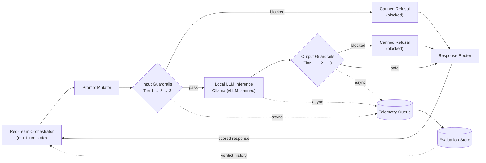

# LLM Red-Teaming and Guardrails

A local-first research project that connects **adaptive, multi-turn adversarial testing** of an LLM with a **live, tiered defense cascade**, and measures the interaction end to end — attack success, false positives, and latency overhead — rather than evaluating offense and defense in isolation.

> **Status:** This document specifies the intended architecture. See [§9 Project Status](#9-project-status-and-future-work) for what is implemented versus planned.

---

## 1. Project Overview

Most LLM security work treats red-teaming and guardrailing as separate problems: an offensive tool (e.g. Garak, PyRIT) attacks a bare model and reports how often it succeeds; a defense tool (e.g. NeMo Guardrails) sits in front of a model and is evaluated on whether it blocks a fixed prompt set. Neither is commonly evaluated against the other, live, in a closed loop.

This project builds that closed loop: a stateful red-team orchestrator sends adversarial, multi-turn prompts at a **three-tier input guardrail → local LLM → three-tier output guardrail** pipeline. Every verdict, at every tier, is logged asynchronously. The resulting Attack Success Rate (ASR), False Positive Rate (FPR), and latency overhead are measured directly against the deployed defense, not against the raw model.

The system is **local-first by design**: inference runs through Ollama (vLLM is a planned alternative backend), the safety classifier is a locally-hosted Llama Guard model, and no component requires a paid or closed-source API. This keeps the full attack-defense-evaluation loop reproducible on a single machine.

---

## 2. Problem Statement and Motivation

**Problem:** Offensive and defensive LLM security tooling are developed and evaluated independently. Red-teaming frameworks measure how often an attack succeeds against a bare generator. Guardrail frameworks measure how often a fixed test set is blocked. Because the two are rarely connected, three practical questions go unanswered for any given deployment:

1. What is the actual attack success rate against the _defended_ system, not the undefended model?
2. What does that defense cost in false positives on real, domain-specific traffic?
3. What latency overhead does the defense add, and where does it come from?

**Why it matters:** A guardrail that looks effective against a static benchmark can still be bypassed by an adaptive, multi-turn attacker, and a guardrail tuned for high recall can silently cripple legitimate technical traffic (code review, security write-ups, domain terminology). Measuring attack, defense, and cost together — in one evaluation store, versioned over time — is what lets a defense configuration be judged as a real trade-off rather than a single pass/fail number.

---

## 3. System Architecture

The pipeline has nine components, executed in this order for every conversational turn:

| #   | Component                        | Responsibility                                                                                                                                                                                               |
| --- | -------------------------------- | ------------------------------------------------------------------------------------------------------------------------------------------------------------------------------------------------------------ |
| 1   | **Red-Team Orchestrator**        | Drives one adversarial conversation per attack run; holds per-conversation state (`AttackState`) across turns so attacks can escalate instead of running single-shot.                                        |
| 2   | **Prompt Mutator**               | Applies an attack technique to the next prompt — role-play wrapping, encoding, payload splitting, or a crescendo escalation step — based on the orchestrator's chosen probe.                                 |
| 3   | **Three-Tier Input Guardrails**  | Screens the prompt _before_ it reaches the model: regex/canary check → embedding similarity → conditional Llama Guard classification. See §4.                                                                |
| 4   | **Local LLM Inference**          | Generates a response via Ollama (`/api/generate`; vLLM support is planned), isolated behind the input guardrail.                                                                                            |
| 5   | **Three-Tier Output Guardrails** | Runs the same three-tier check on the model's response before it leaves the system (canary-leak and PII scanning included).                                                                                  |
| 6   | **Response Router**              | Applies the final verdict: returns the response unmodified (`safe`), substitutes a canned refusal (`blocked`), or redacts (`partial`).                                                                       |
| 7   | **Asynchronous Telemetry**       | Every tier emits a `{turn_id, stage, verdict, score, latency_ms}` event to a non-blocking queue/topic. Telemetry failures never affect the guardrail decision or response latency.                           |
| 8   | **Evaluation Store**             | Persists verdicts and full conversation transcripts, keyed by `conversation_id` and `guardrail_version`, for ASR/FPR/latency computation and offline replay.                                                 |
| 9   | **Feedback Loop**                | The orchestrator reads prior verdicts (which tier blocked, at what turn) to decide how to escalate the _next_ attack — and, separately, accumulated transcripts are the input to the calibration work in §6. |

### Architecture diagram

- **Normal path:** Orchestrator → Mutator → Input Guardrails (pass) → Local LLM → Output Guardrails (safe) → Response Router → scored response back to the Orchestrator.
- **Input-blocking path:** Input Guardrails stop the request before the model is ever called; a refusal is routed back immediately.
- **Output-blocking path:** The model runs, but its response is withheld or redacted by the Output Guardrails.
- **Feedback:** The Evaluation Store's verdict history informs how the Orchestrator escalates subsequent turns and runs.

---

## 4. Three-Tier Defense Cascade

The same three tiers run twice per turn — once on the incoming prompt, once on the model's response — so canary-leak and PII checks apply symmetrically in both directions.

| Tier  | Check                                                    | Latency budget | Runs                                             |
| ----- | -------------------------------------------------------- | -------------- | ------------------------------------------------ |
| **1** | Regex / deny-list matching, canary-token echo detection  | < 60 ms        | Always                                           |
| **2** | Embedding cosine-distance against known-attack centroids | ~10–20 ms      | Always                                           |
| **3** | Llama Guard safety classification                        | ~150–400 ms    | Only when Tier 2's similarity score is ambiguous |

**Why cheapest-first:** Tier 1 and Tier 2 are near-constant-time and catch the large majority of clearly benign or clearly malicious traffic. Tier 3 is the most accurate but also the most expensive, since it requires a full forward pass through a classifier model — routing only ambiguous cases to it keeps the cascade's average latency low without lowering its ceiling on detection quality.

**Why conditional Tier 3:** Invoking a classifier on every request would make the cascade's cost scale with total traffic rather than with actual ambiguity. Making the invocation conditional on Tier 2's output is what keeps the defense's latency distribution bimodal (fast for clear cases, slower only when needed) instead of uniformly slow.

**Why both directions:** A prompt can pass Tier 1–3 cleanly and still cause the model to leak a canary token, system-prompt fragment, or PII in its output. Running the identical cascade on the response is what catches that class of failure, and reusing the same tier implementations for both directions avoids maintaining two separate detection logics.

---

## 5. Evaluation Methodology

All metrics are computed from the Evaluation Store's per-turn verdict records — no separate instrumentation is required.

| Metric                        | Definition                                                      |
| ----------------------------- | --------------------------------------------------------------- |
| **Attack Success Rate (ASR)** | successful attacks ÷ total evaluated attacks                    |
| **False Positive Rate (FPR)** | benign requests incorrectly blocked ÷ total benign requests     |
| **Latency overhead**          | guardrail processing time ÷ total request time, as a percentage |

Each is reported with more than a single aggregate number:

- **ASR** is stratified by attack category, by turn depth (to show whether defenses degrade as a multi-turn conversation escalates), and by which guardrail tier was reached.
- **FPR** is measured against a project-specific benign set covering categories known to trip naive guardrails — security code review, penetration-test write-ups, role-play fiction, and domain technical text — and is reported per tier so over-blocking can be attributed to a specific layer.
- **Latency overhead** is reported at **p50, p95, and p99**, not mean, since the conditional Tier 3 call makes the distribution bimodal. The **Tier-3 invocation rate** (share of requests escalated past Tier 2) is reported alongside it, since overhead is a direct function of that rate.
- **Multi-turn attacks** are additionally tracked for **partial compliance** — cases where no single turn fully succeeds but information is extracted incrementally across turns — since a per-turn ASR alone would miss this.

**External benchmarks referenced in the design:**

- **CircleGuardBench** — a published benchmark for guard-model harm detection, jailbreak resistance, false positives, and latency across multiple harm categories. Intended to benchmark the Tier 3 classifier (and the full cascade) against a comparable, external standard.
- **Tensor Trust** — a dataset of adversarial prompt injections collected from an attacker/defender game. Intended as a source of real, human-discovered injection phrasing for the ASR attack set, rather than relying solely on synthetic templates.
- **Project-specific benign set** — no public benchmark substitutes for domain-specific FPR measurement; this set must be curated from the target deployment's own traffic or documents.

The planned external benchmarks above have not been run yet. One committed pilot run does exist and is reported in §9; the section that follows describes the evaluation design those and future runs follow.

---

## 6. Research Contributions

Two proposed innovations distinguish this project from a standard red-team/guardrail implementation. Both are **proposed and testable, not yet demonstrated**.

### Innovation 1: Attack-Driven Calibration

**Idea:** Instead of hand-picking Tier 2/Tier 3 thresholds once, periodically re-tune them using the project's own accumulated red-team transcripts, then validate on a held-out split.

**Test design:** Split recent red-team runs into a calibration set and a held-out set. Search thresholds that minimize ASR on the calibration attacks while holding FPR (on the §5 benign set) within a tolerance. Compare the resulting ASR/FPR pair on the held-out set against the pair produced by the original, static thresholds. Success is a strictly better ASR-at-equal-FPR (or FPR-at-equal-ASR) point, ideally shown across several calibration cycles.

### Innovation 2: Minimum Sufficient Defense Routing

**Idea:** Replace the fixed Tier 2 similarity threshold that decides when Tier 3 is invoked with a lightweight learned router (e.g. logistic regression over Tier 1/Tier 2 features), trained to predict whether Tier 3 would actually change the verdict.

**Test design:** Hold the cascade fixed except for the routing policy. Compare a static-threshold baseline against the learned router on the identical attack and benign sets, reporting Tier-3 invocation rate, p50/p95/p99 latency, ASR, and FPR side by side. Success is a materially lower invocation rate with ASR and FPR statistically indistinguishable from the baseline, within a pre-registered equivalence margin.

---

## 7. Technology Stack

| Layer                      | Core technology                                                                                              | Notes                                                                                    |
| -------------------------- | ------------------------------------------------------------------------------------------------------------ | ---------------------------------------------------------------------------------------- |
| Language                   | Python                                                                                                       | Guardrail libraries, evaluation tooling                                                  |
| Inference                  | Ollama                                                                                                       | Local-only; vLLM is a planned alternative serving backend                                 |
| Interface layer            | Streamlit dashboard (`src/safety_platform/app.py`) and a CLI evaluation harness; a FastAPI `/v1/chat` service is planned | The dashboard is a local closed-loop demo; the CLI runs and reports benchmark evaluations |
| Tier 2 detection           | Local sentence-embedding model (e.g. a `sentence-transformers`-class model, or an Ollama embedding model)    | Cosine similarity against an attack-centroid index                                       |
| Tier 3 detection           | Llama Guard (served locally via Ollama)                                                                      | Invoked conditionally                                                                    |
| Telemetry                  | Async queue (`asyncio.Queue`) for single-node; Kafka/Redpanda as an alternative for multi-worker deployments | Non-blocking, bounded, drops telemetry under backpressure rather than blocking responses |
| Evaluation storage         | SQLite (committed); Postgres/DuckDB as a planned alternative at scale                        | Stores per-turn verdicts and transcripts                                                 |
| Red-teaming design pattern | Garak-style probes / PyRIT-style orchestrator-converter composition                                          | Design pattern referenced, not a direct dependency                                       |
| Benchmarks                 | CircleGuardBench, Tensor Trust                                                                               | External datasets for evaluation, per §5                                                 |

No component requires a paid or closed-source API.

---

## 8. Security and Limitations

- **Guardrails reduce risk; they do not eliminate it.** Both the input and output cascades are probabilistic filters — a sufficiently novel prompt or response can pass undetected, and the system should not be presented as providing complete protection.
- **False positives and false negatives are both expected.** Regex/deny-list and embedding-based tiers can over-block legitimate technical content (§5) and under-block novel phrasing; the Llama Guard classifier inherits whatever gaps exist in its own training and calibration.
- **Held-out evaluation is required, not optional.** Thresholds or routing policies tuned and tested on the same data will overstate performance; the calibration workflow in Innovation 1 depends on a strict calibration/held-out split to be meaningful.
- **Automated safety classification has known limits.** Llama Guard (or any similar classifier) reflects the categories and phrasing it was trained or calibrated on; it is one signal in the cascade, not a ground truth.
- **This is an experimental research system.** It is designed for measurement and study of attack/defense dynamics, not as a production-hardened security boundary.

---

## 9. Project Status and Future Work

| Category                       | Status                                                                                                                                                                                                                              |
| ------------------------------ | ----------------------------------------------------------------------------------------------------------------------------------------------------------------------------------------------------------------------------------- |
| **Architecture specified**     | All nine components (§3), the three-tier cascade (§4), the evaluation methodology (§5), and both research contributions (§6) are fully specified in this document.                                                                  |
| **Implemented**                | The three-tier guardrail libraries (Tiers 1–3, response router, telemetry bus/consumer/store) live in `src/safety_platform/`; a Streamlit closed-loop dashboard (input-direction demo, local Tier-3 stub) and a CLI evaluation harness (`python -m safety_platform.evaluation`) are runnable; the output-direction arbitration prompt per the tuned design is implemented in the Tier-3 connector. Don't rely on the dashboard as a benchmark: its Tier 3 is a local stub and its target model is not connected. |
| **Measured on a pilot sample** | A committed 60-case JBB v2 held-out evaluation (run `20261029T015710-587cb28a`, results in `evaluation/results/`) produced a credible negative finding: ASR 6.7% across baseline/input/full, FPR 10.0%, guard p95 ≈ 21 s, Tier-3 rate 51.7% (input) / 53.3% (full). This is a pilot-grade sample, not a success claim. |
| **Planned**                    | Red-team orchestrator, prompt mutators, and multi-turn/partial-compliance evaluation; FastAPI `/v1/chat` service; calibration of the output-arbitration prompt on stored responses; canary/deny-list/PII output scanning; CircleGuardBench and Tensor Trust loaders; per-tier FPR attribution; Postgres/DuckDB/Kafka backends. |
| **Experiments still required** | Larger held-out reruns beyond the 60-case pilot; the Innovation 1 calibration A/B; the Innovation 2 routing A/B (a trained-routing artifact, not hardcoded weights); iterative calibration cycles.                                   |

The implementation state in this section reflects the current repository: guardrail libraries, telemetry, dashboard demo, and the evaluation harness are built and quality-gated (pytest/coverage/black/ruff/mypy/pyright), and one committed pilot evaluation produced a negative finding recorded with its full configuration — the numbers above are reported honestly as a negative result, not evidence of success.
