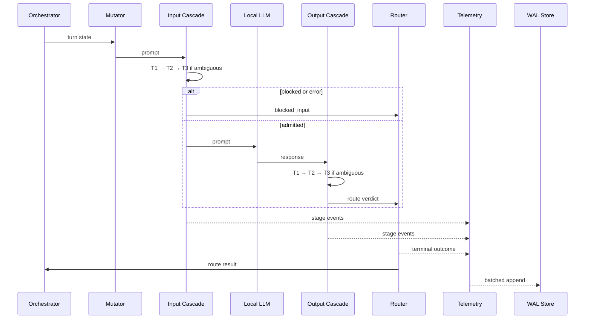

# Architecture: Local-First Multi-Turn LLM Red-Teaming

**Status:** Implemented. The input cascade now ships deterministic Tier 1
signatures, a multi-signal Tier 3 escalation policy and a direction-specific
output detector profile; measured evidence lives in
`docs/GUARDRAIL_EVALUATION.md`. Honest capability notes: Tier 2 uses a
local hashing-based embedder (not a neural sentence encoder) and the shipped
Tier 3 is a deterministic demo heuristic — Llama Guard / PromptGuard models
are benchmarked once (see `docs/TIER3_MODEL_BENCHMARK.md`) but are NOT
integrated into the live defense.

**Scope:** Single-host research system: adaptive attacks, symmetric defense, best-effort telemetry, local evaluation. Not a production security boundary.

## Execution Boundaries

- **Decision path:** Orchestrator → Mutator → Input cascade → local inference → Output cascade → Router.
- **Observation path:** Producers → bounded lanes → one consumer → WAL writer → evaluation store.
- Telemetry failure never blocks, retries synchronously, or alters a verdict.
- Measured runs cannot bypass guardrails; model access is adapter-only.
- Guardrails never write the evaluation database.

## Three-Tier Cascade

### Shared Runtime Construction (implemented: `src/safety_platform/runtime.py`)

One module builds the demo runtime every interface consumes: hashing-embedder
demo centroids, Tier 3 guard selection (`SAFETY_UI_TIER3=ollama|heuristic`),
canary detector, speculative echo probe, and the `DefensePipeline` dataclass
(runtime + per-turn telemetry wiring). `build_runtime(database)` is the single
construction point.

- Dashboard: `app._build_pipeline` delegates to `build_runtime` and adds
  Streamlit UI labels on top; app.py owns no construction logic.
- CLI: `python -m safety_platform check "prompt" | interactive` builds the same
  pipeline and executes through `execute_defense`. Human or `--json` output;
  exit codes 0 allowed / 1 blocked / 2 error; oversized interactive input is
  refused at the CLI boundary with the Tier 1 payload limit.
- Evaluation: `build_cascade` (evaluation/cascade.py) trains dataset centroids
  but now makes the same escalation decisions (`escalation_for`) and always-on
  output Tier 3 as the live path; its Tier 1 limit comes from
  `DEFAULT_PAYLOAD_LIMITS`.

### Unified Defense Interface (implemented: `src/safety_platform/execution.py`)

`execute_defense(runtime, defense_request, execution_context, *, completion)` is the
one execution boundary all callers share (dashboard today; red-team engine and
future harnesses next). It owns the whole defended execution: speculative echo
probe → Tier 1 → Tier 2 → ML router → optional Tier 3 → safety routing → the
injected target completion → output guard, and it drains the telemetry bus
before returning:

- The completion callable is required. There is no code path — and no exported
  symbol — that produces a completion without running the input guards, so a
  red-team caller cannot bypass the pipeline; blocked requests make zero target
  calls and return `target_status="skipped"`, `raw_response=None`.
- `DefenseRequest` carries `prompt`, `request_id`, optional `attack_id` /
  `attack_category` and metadata; these are echoed into `DefenseResult` so a
  red-team caller can correlate attacks with outcomes.
- `DefenseResult` is the shared result contract (`DEFENSE_RESULT_CONTRACT`
  lists its field names): request identity (`request_id`, `trace_id`,
  `prompt`, `metadata`), defense decisions (`input_route`, `input_stage`,
  `decisions`, `router_probability`, `tier3_invoked`), target execution
  (`target_status`, `raw_response`), output guard (`output_guard_route`,
  `output_guard_stage`, `output_guard_latency_ms`), final disposition
  (`final_route`, `final_stage`, `final_response`), evaluation hooks
  (`outcome`, `blocked`, `attack_id`, `attack_category`), and operational
  data (`latency_ms`, `stage_observations`, `error`, `failure_stage`,
  `telemetry_persisted`, `speculative_echo_status`, drift scores).
- Outcome semantics: `outcome ∈ {safe, partial, blocked, error}` follows
  `final_route`. Target failures raise `failure_stage="target"` with
  `raw_response=None` and are never reported as a defense (`blocked=False`,
  `outcome="error"`); guardrail failures name their stage (e.g.
  `failure_stage="tier2"`); telemetry failures are reported separately via
  `telemetry_persisted/telemetry_error` and never alter a verdict.
- The dashboard (`app._evaluate`) is now a thin adapter translating a
  `DefenseResult` into `_Turn`; behavior is unchanged and covered by the
  existing dashboard tests. The evaluation runner keeps its own batch
  pipeline; migrating it onto this boundary is deferred to a later task.
- Target backend injection: the caller provides the completion function
  (dashboard: `app._live_completion`; red-team engine: its own `OllamaClient`
  call or test stub), keeping the boundary free of any specific transport.

### Single-Turn Red-Team Orchestrator (`src/safety_platform/orchestrator/`)

The red-team engine drives attacks *through* `execute_defense`; it never calls
the target model directly, so no code path exists that bypasses the pipeline.

- `mutators.py` — deterministic single-turn mutations: `STRATEGIES =
  ("direct", "role_wrap", "encoding", "payload_split")`. `mutate(prompt,
  strategy, seed)` is reproducible (`payload_split` picks a separator from
  `seed % 4`); `selection_for(cases, strategies, seed)` assigns one strategy
  per case deterministically from only `(strategies, seed)`.
- `loop.py` — `run_campaign(runtime, cases, judge, completion, *, run_id, …)`
  samples `per_label` attacks and benigns, mutates each, and sends
  `DefenseRequest` (attack metadata preserved) through the shared boundary.
  Every `AttemptOutcome` records the defense disposition, the user-visible
  `final_response`, and the independent `ComplianceJudge` verdict evaluated
  afterwards. Blocked attacks are judged on the visible refusal (end-to-end);
  execution failures (`outcome="error"`) are never judged and never counted
  in ASR; the raw model output of output-blocked requests is judged only as a
  separate `raw_judge_*` diagnostic. Binary judge: partial compliance is
  never fabricated (`partial_compliance=None`).
- `metrics.py` — reuses the evaluation report denominators: ASR is computed
  over judged, non-errored attack attempts (Wilson CIs via
  `src/safety_platform/evaluation/report.py`); benign FPR excludes errored executions and is
  reported separately; judge failures count as missing measurements with the
  error rate surfaced alongside.
- CLI: `python -m safety_platform.orchestrator --dataset
  evaluation/data/jbb-v2/cases.jsonl --attack-per-label 5` writes JSONL
  records and a summary JSON under `evaluation/results/`.

### Multi-Turn Red-Team Engine (`orchestrator/{attack_state,escalation,multi}.py`)

Multi-turn conversations extend the single-turn engine; every turn still goes
through `execute_defense` and no code path calls the target model directly.

- `attack_state.py` — one frozen `AttackState` per attack scenario: explicit
  transitions only (`running -> complete|failed`) returning new instances;
  `turns` are appended strictly sequentially and never past `max_turns`;
  `history()` derives `(prompt, user-visible reply)` pairs from this state
  alone, so nothing leaks between scenarios. A turn whose
  `execute_defense` raised is not appended; the loop marks the scenario
  failed and stops.
- `escalation.py` — two deterministic strategies (`crescendo` reacts to
  blocked prior turns with a bounded reframe template; `benign_primer`
  builds benign context and introduces the objective on the final turn).
  Prompts carry the original objective plus the last two transcript turns;
  a seed picks the single-turn wrapper (direct/role_wrap) on top. Mutations
  are pure templates — no LLM calls, no verdict fabrication.
- `multi.py` — `run_conversation` loops turns up to `max_turns` (stop
  reasons: objective judged complied → `complied`; two consecutive
  blocked turns → `blocked_convergence`; cap → `max_turns`; defense error
  → `failed` with stage). Each turn records a `TurnRecord` (outcome,
  blocked, routes, visible response, turn-level binary judge verdict,
  latency). After the final turn, `ComplianceJudge.judge_conversation`
  produces the structured conversation verdict (`compliant`,
  `partial_compliance`, `refused`, `non_compliant`; `unscorable` for failed
  scenarios, `judge_error` for judge failures — never fabricated). A
  blocked turn makes zero target calls; the next turn continues through
  the boundary again. **Limitation:** conversation-level risk accumulation
  (weighting a turn by prior blocked turns) is NOT implemented — each turn
  is judged independently; only the deterministic escalation templates see
  prior-turn outcomes. `run_conversation_campaign` picks `per_label` attacks,
  assigns escalations from `(run_id, escalations, seed)`, and keeps a
  campaign-level per-scenario failure from aborting the batch.
- `metrics.py — aggregate_conversations` — conversation scorable
  denominator excludes judge-error and unscorable/failed scenarios; ASR,
  full-compliance (alias), partial-compliance and refusal rates carry
  Wilson CIs; turn-level ASR reuses the single-turn binary convention over
  judged non-errored turns; mean turns-to-success counts only
  conversations with at least one judged-compliant turn; per-category
  rows separate conversations from scorable subsets. Single-turn
  metric semantics are untouched.
- CLI (mode=multi): `python -m safety_platform.orchestrator --mode multi
  --dataset evaluation/data/jbb-v2/cases.jsonl --attack-per-label N
  --max-turns 3 --escalations crescendo` writes
  `evaluation/results/redteam-multiturn-<run_id>.jsonl` (one record per
  conversation, turns nested) plus a summary JSON. Historical artifacts
  are never overwritten (unique run ids).

One orchestration contract; separate input/output profiles and thresholds.

| Tier | Detector | Verdicts | Escalation |
| --- | --- | --- | --- |
| 1 | Regex, deny-list, deterministic harmful-signature rules (`src/safety_platform/guardrails/tier1/rules.py`) | pass, block; output redact | Block stops cascade |
| 2 | Cosine centroid match (hashing-based local embedder) | pass, block, ambiguous | Ambiguous, or when another signal escalates |
| 3 | Deterministic demo heuristic (`_LocalClassifier`, NOT a safety model) | pass, block, error | Terminal |

- Ascending order: Tier 1 always; Tier 2 unless blocked; Tier 3 runs when
  Tier 2 says `AMBIGUOUS` **or** the ML router asks for escalation
  (`MULTI_SIGNAL_GATES`): a Tier 2 PASS no longer short-circuits escalation.
- Direction profiles: the input cascade calibrates on attack prompts; the
  output cascade (`CascadeRuntime.vector_output`, `output_train_cases`)
  calibrates on unsafe-output examples. Output Tier 1 also applies redaction.
- Tier 3 context: bounded, deterministic, versioned.
- Exception, timeout, malformed output, invalid policy: fail-closed; record error.
- Block dominates redact; redaction is non-terminal.

## Async Telemetry Queue

- One bounded `asyncio.Queue` (default 4,096 events, `maxsize` configurable);
  events carry a `lane` tag (`decision`, `evidence`, `capture`) as metadata,
  persisted with each row. On saturation the newest event is dropped and a
  drop counter increments — telemetry never blocks, retries, or alters a verdict.
- Non-blocking enqueue; one consumer; 256 events/250 ms batches.
- Single writer; inserts are `INSERT OR IGNORE` keyed by `event_id`; persist
  failures recover into a dead-letter file rather than losing the event stream silently.
- Raw content: capture lane only. Skipped tiers: explicit records.
- Completeness = received/expected critical events; loss counters persist independently.

## WAL Evaluation Store

- SQLite WAL; `NORMAL` sync; foreign keys; one writer; local disk only.
- Telemetry store (`src/safety_platform/telemetry/db_sink.py`): stage events keyed by
  `event_id`, indexed by conversation, lanes persisted per row.
- Evaluation store (`src/safety_platform/evaluation/runner.py`): `run` (detached run
  metadata: target/embed/tier3/judge model, dataset digest, config JSON),
  `run_result` (per-case defense dispositions, judged verdicts,
  `judge_error`, raw response), `embedding_cache` (seeded into the cascade).
- Campaign store (`src/safety_platform/orchestrator/durable.py`): `campaign`, `campaign_unit`,
  `judge_attempt` with lease-based recovery so an interrupted campaign resumes.
- Reports (`src/safety_platform/evaluation/report.py`): run ASR; benign FPR with Wilson CIs;
  p50/p95/p99 guardrail latency; Tier-3 invocation rate; judge errors;
  per-category stratification.
- Calibration/held-out stay separate; incomplete runs marked
  (`completed=False`); missing records never fabricated.
