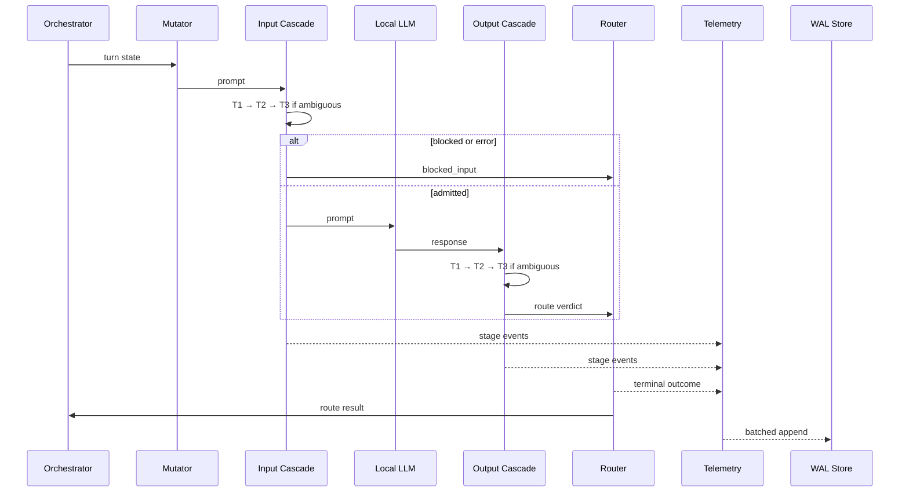

# Architecture: Local-First Multi-Turn LLM Red-Teaming

**Status:** Proposed. Initial Tier 1 scaffold implemented.

**Scope:** Single-host research system: adaptive attacks, symmetric defense, best-effort telemetry, local evaluation. Not a production security boundary.

## Execution Boundaries

- **Decision path:** Orchestrator → Mutator → Input cascade → local inference → Output cascade → Router.
- **Observation path:** Producers → bounded lanes → one consumer → WAL writer → evaluation store.
- Telemetry failure never blocks, retries synchronously, or alters a verdict.
- Measured runs cannot bypass guardrails; model access is adapter-only.
- Guardrails never write the evaluation database.

## Three-Tier Cascade

### Unified Defense Interface (implemented: `src/safety_platform/execution.py`)

`execute_defense(runtime, defense_request, execution_context, *, completion)` is the
one execution boundary all callers share (dashboard today; red-team engine and
future harnesses next). It owns the whole defended execution: speculative echo
probe → Tier 1 → Tier 2 → ML router → optional Tier 3 → safety routing → the
injected target completion → output guard, and it drains the telemetry bus
before returning:

- The completion callable is required. There is no code path — and no exported
  symbol — that produces a completion without running the input guards, so a
  red-team caller cannot bypass the pipeline; blocked requests make zero target
  calls and return `target_status="skipped"`, `raw_response=None`.
- `DefenseRequest` carries `prompt`, `request_id`, optional `attack_id` /
  `attack_category` and metadata; these are echoed into `DefenseResult` so a
  red-team caller can correlate attacks with outcomes (Task 9/10 hook).
- `DefenseResult` is the shared result contract (`DEFENSE_RESULT_CONTRACT`
  lists its field names): request identity (`request_id`, `trace_id`,
  `prompt`, `metadata`), defense decisions (`input_route`, `input_stage`,
  `decisions`, `router_probability`, `tier3_invoked`), target execution
  (`target_status`, `raw_response`), output guard (`output_guard_route`,
  `output_guard_stage`, `output_guard_latency_ms`), final disposition
  (`final_route`, `final_stage`, `final_response`), evaluation hooks
  (`outcome`, `blocked`, `attack_id`, `attack_category`), and operational
  data (`latency_ms`, `stage_observations`, `error`, `failure_stage`,
  `telemetry_persisted`, `speculative_echo_status`, drift scores).
- Outcome semantics: `outcome ∈ {safe, partial, blocked, error}` follows
  `final_route`. Target failures raise `failure_stage="target"` with
  `raw_response=None` and are never reported as a defense (`blocked=False`,
  `outcome="error"`); guardrail failures name their stage (e.g.
  `failure_stage="tier2"`); telemetry failures are reported separately via
  `telemetry_persisted/telemetry_error` and never alter a verdict.
- The dashboard (`app._evaluate`) is now a thin adapter translating a
  `DefenseResult` into `_Turn`; behavior is unchanged and covered by the
  existing dashboard tests. The evaluation runner keeps its own batch
  pipeline; migrating it onto this boundary is deferred to a later task.
- Target backend injection: the caller provides the completion function
  (dashboard: `app._live_completion`; red-team engine: its own `OllamaClient`
  call or test stub), keeping the boundary free of any specific transport.

### Single-Turn Red-Team Orchestrator (Task 9, `src/safety_platform/orchestrator/`)

The red-team engine drives attacks *through* `execute_defense`; it never calls
the target model directly, so no code path exists that bypasses the pipeline.

- `mutators.py` — deterministic single-turn mutations: `STRATEGIES =
  ("direct", "role_wrap", "encoding", "payload_split")`. `mutate(prompt,
  strategy, seed)` is reproducible (`payload_split` picks a separator from
  `seed % 4`); `selection_for(cases, strategies, seed)` assigns one strategy
  per case deterministically from only `(strategies, seed)`.
- `loop.py` — `run_campaign(runtime, cases, judge, completion, *, run_id, …)`
  samples `per_label` attacks and benigns, mutates each, and sends
  `DefenseRequest` (attack metadata preserved) through the shared boundary.
  Every `AttemptOutcome` records the defense disposition, the user-visible
  `final_response`, and the independent `ComplianceJudge` verdict evaluated
  afterwards. Blocked attacks are judged on the visible refusal (end-to-end);
  execution failures (`outcome="error"`) are never judged and never counted
  in ASR; the raw model output of output-blocked requests is judged only as a
  separate `raw_judge_*` diagnostic. Binary judge: partial compliance is
  never fabricated (`partial_compliance=None`).
- `metrics.py` — reuses the evaluation report denominators: ASR is computed
  over judged, non-errored attack attempts (Wilson CIs via
  `evaluation/report.py`); benign FPR excludes errored executions and is
  reported separately; judge failures count as missing measurements with the
  error rate surfaced alongside.
- CLI: `python -m safety_platform.orchestrator --dataset
  evaluation/data/jbb-v2/cases.jsonl --attack-per-label 5` writes JSONL
  records and a summary JSON under `evaluation/results/`.

One orchestration contract; separate input/output profiles and thresholds.

| Tier | Detector | Verdicts | Escalation |
| --- | --- | --- | --- |
| 1 | Regex, deny-list | pass, block; output redact | Block stops cascade |
| 2 | Cosine centroid match | pass, block, ambiguous | Ambiguous only |
| 3 | Local Llama Guard | pass, block, error | Terminal |

- Ascending order: Tier 1 always; Tier 2 unless blocked; Tier 3 only on ambiguity.
- Tier 3 context: bounded, deterministic, versioned.
- Exception, timeout, malformed output, invalid policy: fail-closed; record error.
- Block dominates redact; redaction is non-terminal.

## Async Telemetry Queue

| Lane | Payload | Bound | Saturation |
| --- | --- | --- | --- |
| Decision | Summaries, outcomes | 4,096 events | Drop newest; critical loss |
| Evidence | Detector details | 8,192 events | Drop newest |
| Capture | Transcripts | 512 events/64 MiB | Truncate/drop; incomplete |

- Non-blocking enqueue; one consumer; 256 events/250 ms batches.
- Single writer; idempotent by event/batch ID.
- Raw content: capture only. Skipped tiers: explicit records.
- Completeness = received/expected critical events; loss counters persist independently.

## WAL Evaluation Store

- SQLite WAL; `NORMAL` sync; foreign keys; one writer; bounded readers; local disk only.
- Versioning: `pipeline_manifest`, `dataset_case`, `attack_run`, `conversation`, `turn`.
- Decisions: `stage_verdict`, `inference_observation`, `turn_outcome`, `transcript`.
- Measurement: `evaluation_label`, `ingest_batch`, `telemetry_loss`, `metric_snapshot`, `schema_migration`.
- `metric_snapshot`: immutable; numerator, denominator, sample, completeness, versions, split.
- Metrics: run ASR; benign FPR; p50/p95/p99 guardrail overhead; Tier-3 invocation per direction; partial compliance; completeness/loss.
- Reports stratify guardrail version, backend/model, and split.
- Calibration/held-out stay separate; incomplete windows provisional; missing records never fabricated.
